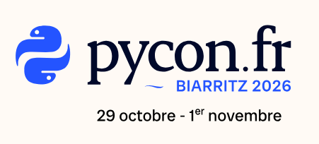
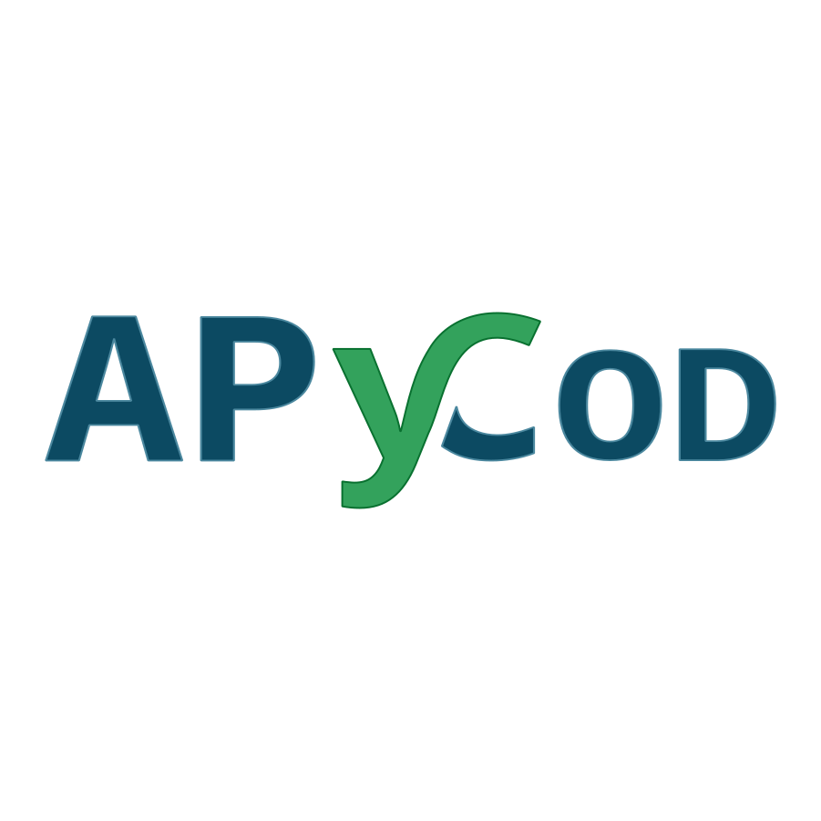
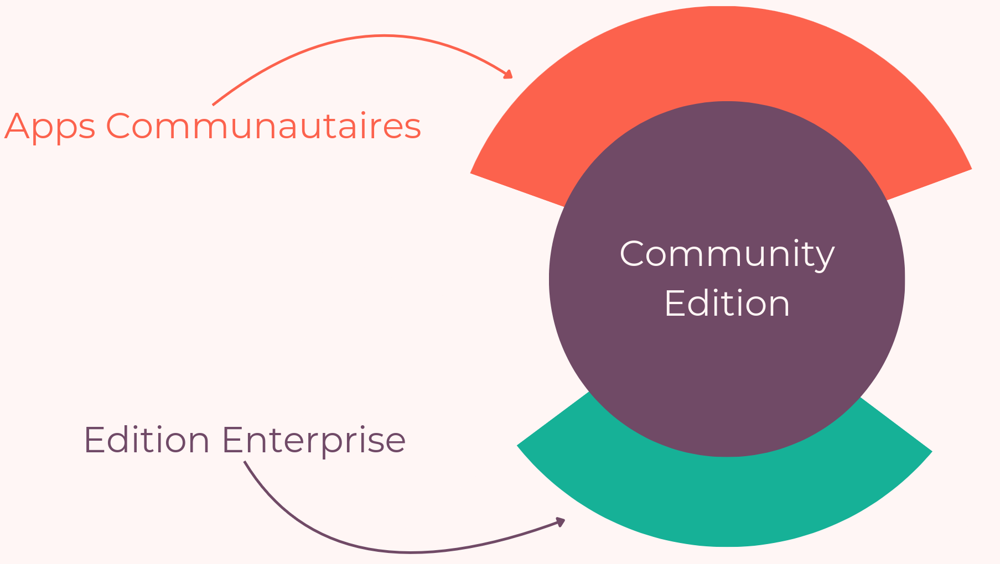
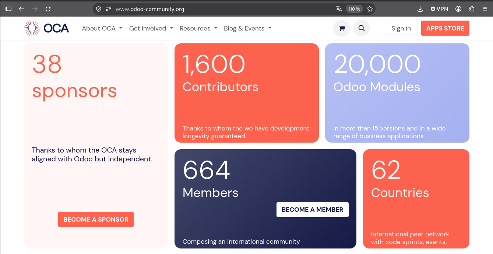
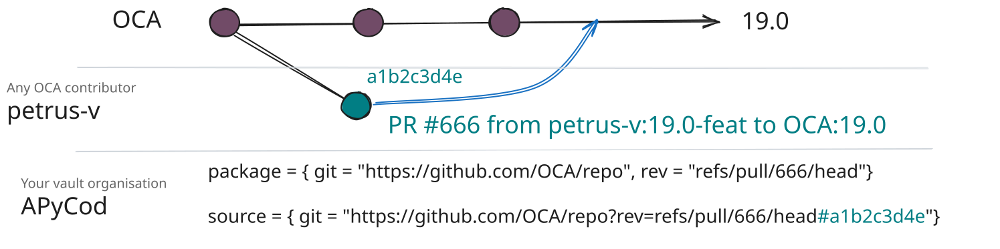
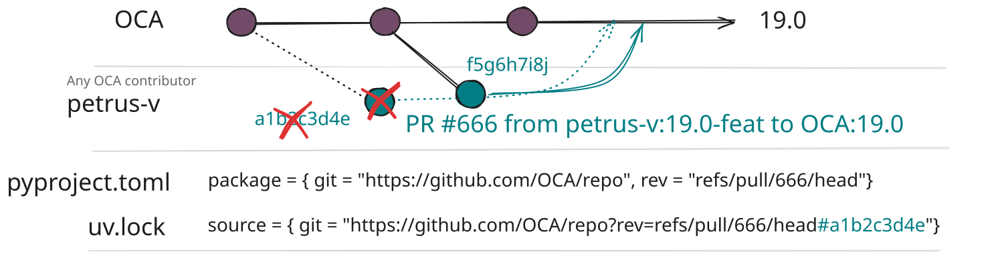
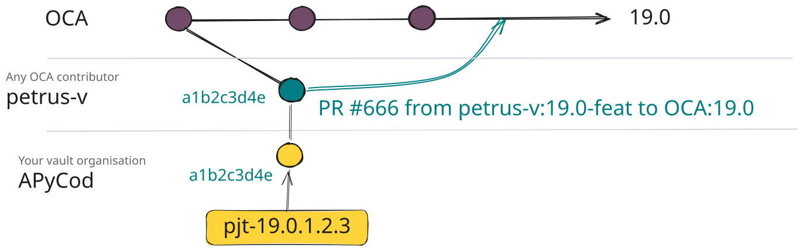
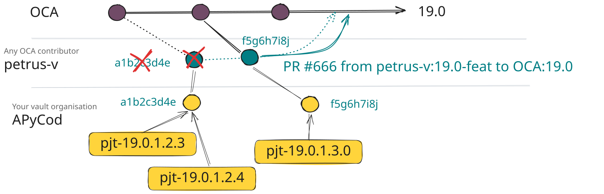
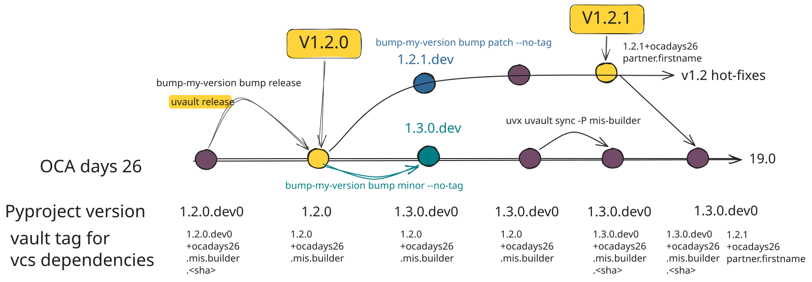

<style scoped>
h1 {
  font-size: 1.55em !important;
  margin-top: 0 !important;
  margin-bottom: 0.3em !important;
}
h1, h1 strong {
  color: var(--color-foreground) !important;
}
h3 {
  margin-top: 0.2em !important;
  margin-bottom: 0.4em !important;
}
p, strong {
  color: var(--color-dimmed) !important;
}
</style>



# **Développer avec Odoo comme n'importe quel projet Python**

### Est-ce vraiment possible ?

**Pierre Verkest (APYCOD)**
GitHub : @petrus-v

<!--
J'avais un rêve ! Gérer mon projet Odoo comme n'importe quel autre projet Python !

Voyons où nous en sommes aujourd'hui !
-->

---

# **À propos**

**Pierre Verkest** — Développeur Python passionné & indépendant @ APYCOD




- gh : @petrus-v
- ln : @pierre-verkest
- Contributeur OCA
- Contributeur pytest-odoo
- Auteur de `uvault`


<!--
Quelques mots sur moi : je suis Pierre Verkest, développeur Python & Odoo indépendant chez APYCOD, contributeur OCA et créateur d'uvault.
[joke] Soyons honnêtes : pendant des années, installer Odoo ressemblait à un combat contre des scripts maison et des configurations --addons-path à rallonge.
Mais aujourd'hui, grâce à des outils comme uv, pyproject.toml, whool et hatch-odoo, Odoo s'intègre naturellement dans les workflows Python standards !
-->

---

# **Au programme**

* Qu'est ce qu'Odoo ?
* Installer Odoo comme un projet Python standard
* **hatch-odoo**: un build backend dédié pour Odoo
* Travailler avec des Pull Requests non mergées

<!--
Voici ce que nous allons aborder aujourd'hui :
1. Faire tourner Odoo comme un projet Python standard avec uv, PyPI et les namespace packages.
2. Utiliser hatch-odoo pour gérer des dossiers d'addons flexibles et des dépendances dynamiques.
3. Gérer la galère du quotidien avec les Pull Requests OCA non publiées.
4. Zoom sur uvault pour sécuriser les dépendances de PR ("vaulter"), travailler en local et gérer les cycles de release.
-->

---

# Odoo... c'est quoi au juste ?


<!--
* **Odoo**: Un progiciel de gestion (ERP) open source
* **Odoo SA**: entreprise commerciale Belge editrice d'Odoo community & Enterprise
* **www.odoo.com**: SAAS Odoo, offre d'hébergement d'Odoo SA
* **odoo.sh**: plateforme de dévelopement et d'hébergement d'Odoo SA
-->

---

# Les modules: Odoo community vs Enterprise




<!--

* Création de nouvelles fonctionnalités: sales, account...
* Techniques: nouveau type dechamp, module de base pour d’autres...
* Amélioration de fonctionnalités existantes sale_coupon, l10n_fr...
* Séparation de l’autorité du code par module
-->
---


---

<!-- _class: lead -->
# **Odoo comme un projet Python standard**

<!--
Commençons par la première partie : initialiser et gérer un projet Odoo comme n'importe quel package Python standard.
Avant de commencer, qu'est-ce que uv et pourquoi l'avons-nous choisi ?
uv est le gestionnaire de packages et de projets Python ultra-rapide d'Astral, écrit en Rust. Il remplace pip, virtualenv, pyenv et pip-tools en un seul binaire.
Nous choisissons uv pour sa rapidité fulgurante, sa gestion transparente des versions de Python, son cache global avec hardlinks qui synchronise les environnements en quelques millisecondes, et son verrouillage déterministe avec uv.lock.
-->

---

# **Initialisation du projet (`uv init`)**

### Configuration du dépôt

```bash
uv init \
  --vcs git \
  --build-backend hatch \
  pyconfr-2026-odoo-dev
cd pyconfr-2026-odoo-dev
```

### Structure du dépôt

```text
pyconfr-2026-odoo-dev/
├── .python-version             # Version cible de Python (ex. 3.14)
├── pyproject.toml              # Métadonnées & dépendances du projet
├── README.md
└── src
    └── pyconfr_2026_odoo_dev
        └── __init__.py         # point d'entrée du package
```

> ⚡ **Résultat** : La racine de votre projet est initialisée avec les fichiers de configuration standards de Python !

<!--
Note du présentateur : Étape 0 (git checkout step-0)
On démarre avec uv init. En quelques millisecondes, uv crée un dépôt Python propre avec pyproject.toml et .python-version.
Remarquez la simplicité de la structure : aucun wrapper Odoo personnalisé, juste des fichiers de configuration Python standards.
-->

---

# **Installation d'Odoo Core & d'un addon personnalisé**

### Addon personnalisé : `src/odoo/addons/pyconfr_2026/__manifest__.py`

```python
{
    "name": "PyConFR 2026 - odoo dev module",
    "version": "20.0.1.0.0",
    "depends": ["web"],
}
```

### Déclaration de la dépendance Odoo dans `pyproject.toml`

```toml
[project]
name = "pyconfr-2026-odoo-dev"
version = "0.1.0"
dependencies = [
    "odoo",
]

[tool.uv.sources]
odoo = { git = "https://github.com/OCA/OCB.git", branch = "20.0" }
```

<!--
Note du présentateur : Étape 1 (git checkout step-1)
Ensuite, nous ajoutons notre module personnalisé sous src/odoo/addons/pyconfr_2026.
Dans pyproject.toml, nous déclarons nos dépendances et pointons odoo directement vers le dépôt Git d'OCB 20.0.
-->

---

# **Lancer Odoo avec `uv run`**


```bash
uv run odoo \
  -d pyconfr2026 \
  -i pyconfr_2026 \
  --stop-after-init
```

> Changement de paradigme avec `uv run` ! L'environnement est synchronisé à la volée !

<!--

### Changement de paradigme : runtime synchronisé à la volée
- **Fini `source .venv/bin/activate`** : `uv run` gère et encapsule l'environnement de façon transparente.
- **Changement de branche sans friction** : Changez de branche Git -> `uv run odoo` resynchronise le `.venv` en **quelques millisecondes** depuis `~/.cache/uv` via des hardlinks, sans même y penser !

Note du présentateur : Étape 1 (suite)
Voici le premier changement majeur : [joke] dites adieu à source .venv/bin/activate !
Avec uv run odoo, uv gère automatiquement l'environnement virtuel pour vous.
Si un collègue ajoute une dépendance, ou si vous changez de branche Git, uv resynchronise votre .venv en une fraction de seconde avant de lancer Odoo. Vous n'avez même plus à y penser !
-->

---

# **Namespace packages Python (`odoo.addons`)**

### PEP 420 : Partager un namespace unique entre plusieurs packages

- **Principe** : Permet à plusieurs distributions indépendantes (Odoo core, modules tiers, custom)
  de fournir des modules au sein du même package Python racine : `odoo.addons`.
- **Configuration avec le build backend `hatchling`** dans `pyproject.toml` :

```diff
+ [tool.hatch.build.targets.wheel]
+ packages = ["src/odoo"]
-[project.scripts]
-pyconfr-2026-odoo-dev = "pyconfr_2026_odoo_dev:main"

[build-system]
requires = ["hatchling"]
build-backend = "hatchling.build"
```

Je peux supprimer le fichier `src/pyconfr_2026_odoo_dev/__init__.py` initialement créé par `uv init`.

> 💡 *Note : Nous utilisons ici le backend `hatchling`. D'autres backends standards comme `flit` ou `uv` supportent aussi les namespace packages PEP 420, avec une syntaxe qui leur est propre.*

---

# **Namespace packages Python (`odoo.addons`)**

### `--addons-path` est MAINTENANT OBSOLÈTE !

`uv run` lie `src/odoo/addons/pyconfr_2026` dans le `.venv` sous `odoo.addons` (en mode editable) :

```bash
uv run odoo -d pyconfr2026 -i pyconfr_2026 --stop-after-init
```

<!--
Note du présentateur : Étape 2 (git checkout step-2)
Comment Odoo trouve-t-il notre module personnalisé ? Grâce aux namespace packages de la PEP 420 !
En configurant module-name = "odoo.addons" dans pyproject.toml, uv installe notre module en mode editable directement dans odoo.addons au sein du .venv.
[joke] Cela signifie que --addons-path est officiellement obsolète ! Odoo importe notre module de façon native.
-->

---

# **Ajouter des dépendances OCA via PyPI**

### Mettre à jour le manifest `src/odoo/addons/pyconfr_2026/__manifest__.py`

```python
    "depends": ["web", "account_usability"],
```

### Ajouter le package PyPI dans `pyproject.toml`

```toml
[project]
...
dependencies = [
    ...
    "odoo-addon-account-usability>=20.0",
]
```

### Exécuter `uv sync`

```bash
uv sync
```

Cela télécharge le module OCA `account_usability` depuis PyPI ! S'il a des dépendances vers d'autres modules OCA, elles seront téléchargées également !

<!--

> 💡 *Note* : vous pouvez utiliser `uv add odoo-addon-mis-builder` pour faire les deux d'un coup :
>   - ajouter la dépendance dans `pyproject.toml`
>   - synchroniser l'environnement virtuel

Note du présentateur : Étape 3 (git checkout step-3)
Et si nous avons besoin d'un addon OCA comme mis_builder ?
Il suffit d'ajouter mis_builder dans le manifest de notre module, et d'ajouter odoo-addon-mis-builder dans pyproject.toml.
Quand on lance uv sync, il récupère automatiquement le wheel depuis PyPI avec toutes ses dépendances requises.
-->

---

# **Sous le capot : PyPI & `whool`**

### Saviez-vous que CHAQUE module OCA est publié sur PyPI ?

- Chaque module OCA est publié comme un **wheel Python standard** sur **pypi.org**.
- Chaque module OCA possède un `pyproject.toml` dans son dossier:

  ```toml
  [build-system]
  requires = ["whool"]
  build-backend = "whool.buildapi"
  ```

- Convention de nommage standard PyPI : `odoo-addon-<nom_du_module>`
  - `account_usability` ➡️ `odoo-addon-account-usability`
- Merci à **Stéphane Bidoul** pour le build backend **`whool`** !


### Ajouter un module OCA devient de la gestion de package Python standard !

```bash
uv add odoo-addon-account-financial-report
```

<!--
Vous vous demandez peut-être : comment est-ce possible ?
Un grand coup de chapeau à Stéphane Bidoul pour la création de whool !
Grâce à whool, chaque module OCA est automatiquement compilé et publié sur PyPI sous la forme d'un wheel standard avec le préfixe odoo-addon-.
[joke] Oui, installer un addon OCA est maintenant aussi simple que de taper uv add odoo-addon-account-financial-report.
-->

---

# **Et Odoo Core dans tout ça ?**

### Pourquoi `odoo = {git = "https://github.com/OCA/OCB.git", branch = "20.0"}"` fonctionne avec `uv` ?

- Dans **`odoo/odoo`** standard, les addons core (`web`, `mail`, ...) se trouvent dans le dossier racine `/addons`.
- Un build Python standard (`pip install .`) n'a pas le comportement attendu dans votre virtualenv (`venv/lib/python3.14/site-packages`).
- **OCA/OCB** intègre nativement un build backend PEP 517 (par Stéphane Bidoul) qui crée des symlinks des addons dans `odoo/addons` lors du build.
- Garantit que **toutes les données de package** (`.xml`, `.csv` et dossiers `static/`) sont correctement incluses dans le wheel.

### Aidez à rendre Odoo upstream installable !
Odoo upstream n'a toujours pas de packaging wheel PEP 517 natif :
- PR d'origine : [#44001](https://github.com/odoo/odoo/pull/44001)
- Forward-port pour la version 19.0 : [#232933](https://github.com/odoo/odoo/pull/232933)

👉 **Votez 👍 et faites du bruit sur la PR #232933** pour inciter Odoo upstream à la merger !

<!--
Note du présentateur :
Vous vous rappelez à l'étape 1 comment nous avons pointé odoo vers OCA/OCB dans pyproject.toml ?
Pourquoi OCB et pas odoo/odoo ?
Parce qu'upstream Odoo ne peut pas être compilé en un wheel propre avec les outils pip/uv standards !
Les addons de base comme web résident dans /addons et ne sont pas packagés par défaut.
Historiquement, les bricolages avec des symlinks ad-hoc donnaient souvent des installations cassées sans vues XML, sans règles CSV ou sans assets JS/CSS statiques.
OCB résout totalement cela : le backend PEP 517 de Stéphane Bidoul crée les symlinks avant la création du wheel, et le MANIFEST.in avec graft odoo garantit que chaque fichier .xml, .csv et asset statique est inclus.
Une PR est ouverte sur odoo/odoo pour la 20.0 (PR #232933, forward-portée de #44001).
Allez voter pour elle et faites du bruit pour qu'Odoo upstream adopte enfin un packaging standard !
-->

---

# **Astuce IDE : Naviguer dans `site-packages` 💡**

### Tout est installé dans `.venv/lib/python3.x/site-packages/`

- Tous les modules OCA et le cœur d'Odoo se trouvent dans votre `.venv`.
- **Bonne pratique recommandée** : Ajoutez `.venv/.../site-packages/odoo/addons` à votre espace de travail IDE (VSCodium / VS Code / PyCharm).

### Principaux bénéfices pour le développeur :
- **Recherche globale dans le code** : Cherchez classes, vues et méthodes dans tous les addons OCA.
- **Débogage fluide** : Placez des breakpoints directement dans n'importe quel module tiers OCA.
- **Go-to-Definition** : Navigation instantanée vers les modèles et méthodes hérités.

<!--
Note du présentateur : (Conseil live demo : montrer l'arborescence VSCodium)
Voici une astuce rapide pour votre IDE : comme tous les addons vivent dans .venv/.../site-packages/odoo/addons, ajoutez ce dossier à votre espace de travail !
Cela débloque la recherche globale instantanée dans tous les addons OCA installés, le saut vers la définition, et vous permet de placer des points d'arrêt de débogage n'importe où dans le code tiers.
-->

---

# **Reproductibilité & Sécurité : `uv.lock`**

### Lockfile déterministe & infalsifiable

- **Lockfile multiplateforme** : Verrouillage multi-OS & multi-versions de Python.
- **Protection de la supply chain** : Vérifie les hashs SHA256 & les commits Git pour empêcher toute altération.
- **Déploiement strict en CI & Production** :
  - `uv sync --locked` : Échoue si `uv.lock` est désynchronisé de `pyproject.toml` (assertion en CI).
  - `uv sync --frozen` : Installe directement depuis `uv.lock` sans le modifier (builds Docker).
- **Export vers formats legacy** : `uv export` vers `requirements.txt` ou `pylock.toml` standard (PEP 751).

> 💡 **Astuce pro (`pre-commit`)** : Gardez `uv.lock` automatiquement synchronisé :

```yaml
- repo: https://github.com/astral-sh/uv-pre-commit
  rev: 0.12.5
  hooks:
    - id: uv-lock
```

<!--
Note du présentateur :
Pour conclure la première partie : uv.lock nous offre une reproductibilité totale et une sécurité de notre supply chain en verrouillant les hashs SHA256.
En CI, on lance uv sync --locked pour s'assurer que uv.lock correspond bien à pyproject.toml. En production ou dans Docker, on utilise uv sync --frozen pour des installations ultra-rapides.
Maintenant que notre environnement est verrouillé et reproductible, voyons comment simplifier encore plus le packaging Odoo !
-->

---

<!-- _class: lead -->
# **Un build backend dédié pour Odoo**
### Simplifier le packaging Odoo avec `hatch-odoo`

<!--
Nous voici dans la deuxième partie !
Jusqu'ici, nous avons utilisé le backend standard uv_build d'Astral, mais il nous contraignait à une arborescence imbriquée (src/odoo/addons/) et à dupliquer manuellement les dépendances.
Voyons comment un build backend dédié comme hatch-odoo résout élégamment tout cela !
-->

---

# **Qu'est-ce qu'un build backend ? (`hatch` & `hatch-odoo`)**

### Définitions & écosystème

- **Build Backend** (PEP 517 / PEP 518) : L'outil chargé de compiler le code source en packages de distribution Python standards (`.whl` wheels ou `.tar.gz` sdist). Exemples : `setuptools`, `flit`, `hatchling`, `uv_build`.
- **Hatch / Hatchling** : Un build backend Python moderne et très extensible, qui supporte des hooks de build et de métadonnées personnalisés.
- **`hatch-odoo`** : Un plugin Hatch spécialisé créé par **Stéphane Bidoul** (ACSONE), conçu sur mesure pour les projets Odoo.

### Quelle est la valeur ajoutée de `hatch-odoo` ?
1. **`addons_dirs` flexible** : Mappe 1 ou plusieurs dossiers du projet dans `odoo.addons` sans la contrainte rigide du dossier `src/odoo/addons/`.
2. **Dépendances dynamiques** : Résout automatiquement les dépendances PyPI directement depuis `__manifest__.py`.

<!--
Avant de regarder hatch-odoo, qu'est-ce qu'un build backend ?
En Python, c'est lui qui compile vos fichiers sources en wheels standards.
hatch-odoo est un build backend spécialisé créé par Stéphane Bidoul chez ACSONE. Il apporte deux fonctionnalités majeures : des répertoires d'addons flexibles et la résolution dynamique des dépendances.
-->

---

# **Chemins d'addons flexibles avec `hatch-odoo`**

### Configurer le build backend `hatch-odoo` dans `pyproject.toml`

```toml
[build-system]
requires = ["hatchling", "hatch-odoo"]
build-backend = "hatchling.build"

# Active le hook de build hatch-odoo pour les dossiers d'addons locaux
[tool.hatch.build.hooks.odoo-addons-dirs]

[tool.hatch-odoo]
addons_dirs = ["src/odoo/addons"]
```

### Pourquoi `addons_dirs` change la donne

**`addons_dirs` de `hatch-odoo`** permet de référencer **n'importe quel** dossier
(ex. `odoo/addons`, `custom_addons`, `third_party/addons`) ou plusieurs dossiers
sans arborescence contraignante !

<!--
Note du présentateur : Étape 4 (git checkout step-4)
Avec uv_build standard, nous devions respecter une arborescence rigide (src/odoo/addons/).
Avec hatch-odoo, nous définissons simplement addons_dirs = ["src/odoo/addons"]. Vous pouvez cibler custom_addons, third_party, ou plusieurs dossiers sans avoir à imbriquer les sous-répertoires.
-->

---

# **Zoom technique : Sous le capot de `hatch-odoo`**

### Comment `hatch-odoo` connecte `addons_dirs` à Python

- **Standards Python impliqués** :
  - **PEP 420** : Implicit Namespace Packages (`odoo.addons`).
  - **PEP 517 / PEP 660** : Build backends & installations en mode editable.
  - **Module `site` & fichiers `.pth`** : Mécanisme standard de Python pour injecter des chemins dans `sys.path` au démarrage.

### Mécanique en mode editable

1. **Arborescence de symlinks** : En mode dev editable, `hatch-odoo` génère `build/__editable_odoo_addons__/odoo/addons/` avec des symlinks vers chaque addon installable de `addons_dirs`. *(Les addons non installables sont ignorés)*.
2. **Fichier `.pth`** : Injecte `<projet>_editable_odoo_addons.pth` dans `.venv/.../site-packages/` pointant vers `build/__editable_odoo_addons__`.
3. ⚡ **Zéro-copie & PEP 420** : Le module `site` de Python lit le `.pth`, ajoutant `build/__editable_odoo_addons__` au `sys.path`. La PEP 420 résout `odoo.addons.<addon>` via les symlinks pointant directement vers votre code source !

> *Mode Wheel de production (`uv build`)* : Aucun symlink n'est utilisé. Les addons sont directement empaquetés dans `odoo/addons/` au sein de l'archive wheel `.whl`.

<!--
Note du présentateur :
Sous le capot, hatch-odoo crée un fichier .pth dans le .venv qui pointe vers un dossier de build contenant des symlinks vers tous vos addons installables.
Python lit le fichier .pth au démarrage et les expose directement dans odoo.addons.
Et lorsque vous buildez un wheel de production avec uv build, tout est packagé proprement sans aucun symlink.
-->

---

# **Dépendances dynamiques avec `hatch-odoo`**

### Déclarer les dépendances dans `src/odoo/addons/pyconfr_2026/__manifest__.py`

```python
"depends": ["web", "account_usability", "web_responsive",]
```

### Activer la résolution dynamique dans `pyproject.toml`

```toml
[project]
dynamic = ["dependencies"]

[tool.hatch.metadata.hooks.odoo-addons-dependencies]
[tool.hatch-odoo]
odoo_version_override = "20.0"
dependencies = [
    "odoo",
    "markdown2",
]
```

> 🪄 **Comment ça marche** : `hatch-odoo` lit le champ `depends` du manifest, résout les packages PyPI (`odoo-addon-partner-firstname`), et les verrouille automatiquement lors de `uv sync` !
> ⚠️ *Contrepartie : on n'utilise plus `uv add` directement.*

<!--
Note du présentateur : Étape 5 (git checkout step-5)
Encore plus fort : hatch-odoo prend en charge les dépendances dynamiques !
Regardez dans pyproject.toml : nous n'avons plus besoin de lister explicitement les packages odoo-addon-* !
En activant dynamic = ["dependencies"], hatch-odoo lit les dépendances dans __manifest__.py et les convertit automatiquement en packages PyPI comme odoo-addon-partner-firstname lors du uv sync.
[joke] Vous ne déclarez plus vos dépendances qu'à un seul endroit : fini la corvée de garder manuellement synchronisés le __manifest__.py et le pyproject.toml !
-->

---

<!-- _class: lead -->
# **Dépendances sur des PR non publiées**

<!--
Abordons maintenant un problème bien réel auquel chaque développeur Odoo est confronté : travailler avec des Pull Requests OCA non encore mergées !
-->
---





---

# **Travailler avec des Pull Requests OCA non mergées**

### PR non mergé sur `OCA/partner-contact#2485`
```python
"depends": ["web", "account_usability", "web_responsive", "partner_firstname", ]
```

```toml
# pyproject.toml
[tool.uv.sources]
odoo = { git = "https://github.com/OCA/OCB.git", branch = "20.0" }
odoo-addon-partner-firstname = { git = "https://github.com/OCA/partner-contact.git", rev = "refs/pull/2485/head", subdirectory = "partner_firstname" }
```

### Lancer `uv sync`

- `uv` utilise la référence Git de la PR.
- Verrouille le commit Git cible exact dans `uv.lock`.

> 💡 **Astuce pro (Dépendances transitives)** : Pour que `[tool.uv.sources]` s'applique à un module *transitif* (sous-dépendance), celui-ci doit être explicitement déclaré comme dépendance directe !

<!--
Note du présentateur : Étape 6 (git checkout step-6)
Très souvent, un correctif de bug ou une nouvelle fonctionnalité se trouve dans une PR OCA ouverte qui n'a pas encore été mergée.
Avec uv, nous pouvons surcharger la source dans [tool.uv.sources] en pointant directement sur refs/pull/827/head.
uv sync récupère le code de la PR directement depuis Git et verrouille le commit exact dans uv.lock.
-->

---

# **Architecture des dépendances de PR**


### Comment `uv` associe les PRs à `uv.lock`

- **Déclaration** : `pyproject.toml` cible `refs/pull/666/head`.
- **Verrouillage** : `uv.lock` capture le hash de commit SHA exact (ex. `a1b2c3d4e`).
- **Résolution** : `uv sync` télécharge `a1b2c3d` depuis le dépôt GitHub amont.



<!--
Note du présentateur :
Voici comment uv gère les dépendances issues de PR : pyproject.toml définit la référence de PR cible, et uv.lock capture le SHA précis du commit.
uv sync télécharge ensuite ce commit spécifique pour construire l'environnement.
-->

---

# **Mode editable local pour contribuer à l'OCA**

### Corriger un bug ou contribuer à la PR OCA en local

```bash
# Cloner le dépôt de la PR en local dans .src/ (ajouté au .gitignore)
git clone https://github.com/OCA/partner-contact .src/partner-contact
```

### Mettre à jour `pyproject.toml` avec la source editable :

```toml
[tool.uv.sources]
odoo-addon-partner-contact = { path = ".src/partner-contact/partner_firstname", editable = true }
```

> ⚡ **Feedback instantané** : Toute modification dans `.src/partner-contact/partner_firstname` est
> immédiatement prise en compte dans Odoo, sans réinstallation ni manipulation de chemins d'addons !

<!--
Note du présentateur : Étape 7 (git checkout step-7)
Si vous voulez modifier cette PR OCA localement, vous clonez le dépôt dans .src/ et déclarez path = ".src/..." avec editable = true.
Tout changement effectué en local est visible instantanément dans Odoo, sans avoir à réinstaller quoi que ce soit ni bidouiller le addons-path !
-->

---

# **Le danger caché : Le Garbage Collector de Git 💣**


### Danger des force-push & rebase en amont !



Si l'auteur de la PR rebase ou force-push, l'ancien commit est **supprimé par le garbage collector** :


```bash
$ uv sync
  ...
  Updating https://github.com/OCA/repo.git (refs/pull/666/head)
  × Failed to download and build `package @ git+https://github.com/OCA/repo.git@a1b2c3d4e#subdirectory=module`
  ├─▶ Git operation failed
  ├─▶ failed to fetch into: ~/.cache/uv/git-v0/a1/b2c3d4e
  ├─▶ failed to fetch commit `a1b2c3d4e`
  ╰─▶ process didn't exit successfully: `git fetch --force --update-head-ok 'https://github.com/OCA/repo.git'
      '+a1b2c3d4e:refs/commit/a1b2c3d4e'` (exit status: 128)
      --- stderr
      fatal : distant error : upload-pack: not our ref a1b2c3d4e
```

> 💥 **Les builds en CI & en production cassent instantanément !**


<!--
Note du présentateur : Étape 8 (git checkout step-8)
Et voici le piège !
[joke] Levez la main si un déploiement en production a déjà planté à 3h du matin parce que l'auteur d'une PR externe a fait un force-push ou un rebase sur sa branche !
Si l'auteur rebase, l'ancien hash de commit est nettoyé par le garbage collector de GitHub.
Votre build CI exécutant uv sync --locked échoue avec l'erreur fatale : "upload-pack: not our ref" !
-->

---


<br/><br/>
<br/><br/>
<br/><br/>
<br/><br/>

## **Comment préserver ces commits de PR pour que nos builds ne cassent jamais ❓**

<!--
En résumé : les URLs Git directes dans pyproject.toml sont une bombe à retardement.
D'abord, les force-push suppriment les commits. Ensuite, les PR peuvent être fermées et les branches supprimées. Enfin, les références de branches ne sont pas immuables.
Alors comment préserver ces commits de PR sous notre propre contrôle pour garantir des builds incassables ?
-->

---

# **La solution : Dépôt distant maîtrisé — coffre fort (vault)**

### Préserver les commits de PR dans un Git Vault géré par votre organisation

- **Figer** : Pousser le commit de PR `a1b2c3d4e` sous forme de tag immuable (`pjt-a1b2c3d4e`) sur votre propre dépôt Vault.
- **Indépendance** : Vos builds dépendent de votre dépôt Vault, les rendant immunisés contre les suppressions en amont.

<div align="center">



</div>

<!--
Note du présentateur :
La solution consiste à "vaulter" (mettre au coffre-fort) les commits des PR non mergées !
Au lieu de pointer sur une branche de PR volatile sur GitHub, on récupère le commit de la PR et on pousse un tag immuable (comme pjt-<sha>) sur un dépôt Git "Vault" qui appartient à notre organisation.
Désormais, notre build dépend intégralement de notre propre dépôt !
-->

---

# **Immunité contre le Garbage Collector**

### Survivre aux force-pushes & rebases

<div align="center">



</div>

<!--
Note du présentateur :
Même si l'auteur de la PR fait un force-push avec un tout nouveau commit, votre dépôt Vault conserve toujours le commit d'origine associé à votre tag.
Vos builds en CI et en production continuent de tourner sereinement sans jamais casser !
-->

---

# **Le hic : faire tout ça à la main est un calvaire 🤯**

> **Le vaulting manuel exige une rigueur extrême et un effort lourd :**
> 
> 1. `git fetch` des refs brutes de PR pour chaque dépendance non mergée.
> 2. Créer les tags et les pousser vers votre dépôt Vault privé.
> 3. Mettre à jour manuellement les sources dans `pyproject.toml` et `uv.lock`.
> 4. Suivre à la main l'état de la PR en amont (mergée, fermée, mise à jour).

### 💡 **Faire cela manuellement est fastidieux et source d'erreurs... Et si un outil s'en chargeait ?**

<!--
Note du présentateur :
[joke] Vaulter les commits à la main, c'est super sur le papier, mais le faire manuellement pour 10 ou 20 PRs, c'est le meilleur moyen de devenir fou.
Il faut récupérer les refs à la main, créer les tags, pousser sur des dépôts distants, mettre à jour pyproject.toml et vérifier le statut de chaque PR.
C'est exactement pour cela que nous avons créé un outil pour tout automatiser : uvault.
-->

---

<!-- _class: lead -->
# **3. ZOOM SUR : `uvault` 🛡️**
### Un outil de workflow VCS dédié à `uv`

<!--
Attaquons la quatrième partie : un zoom approfondi sur uvault !
-->

---

# **Qu'est-ce que `uvault` ?**
<br/>
<br/>

### Un outil pour gérer vos dépendances VCS dans votre environnement de dev `uv`

<br/>

**CLI autonome** exécuté via `uvx` (`uvx --with uvault[github] uvault <commande>`).
  *(Note : `uvx` est le runner d'outils de `uv` — équivalent de `npx` ou `pipx` — exécutant des outils CLI dans des environnements éphémères isolés sans les installer dans votre projet)*
<br/>

Inspiré de **`pip-preserve-requirements`** (par Stéphane Bidoul).

<!--
uvault est un outil CLI exécuté via uvx.
Quelle différence entre uv et uvx ? Alors que uv gère votre projet et vos environnements virtuels, uvx (raccourci pour 'uv tool run', semblable à npx pour Node ou pipx pour Python) exécute des outils CLI autonomes dans des environnements isolés et temporaires à la volée. Pas besoin d'installer uvault dans le .venv de votre projet !

Inspiré de pip-preserve-requirements de Stéphane Bidoul, uvault gère vos dépendances VCS en :
1. Vaultant automatiquement les commits de PR avec des tags immuables dans le repo Vault de votre organisation.
2. Basculant facilement les dépendances en mode editable local.
3. Surveillant le statut des PR amont (mergée, fermée ou force-pushée).
4. Taguant les dépendances pour les releases de production.
-->

---

# **Déclarer l'intention (`uvault add`)**

Plutôt que d'éditer manuellement `pyproject.toml`, déclarez une **intention** de dépendance VCS :

```bash
uvx uvault add odoo-addon-web_switch_company_favorite \
  https://github.com/OCA/multi-company \
  --pr 1020 \
  --subdirectory web_switch_company_favorite
```

### Résultat dans `pyproject.toml` :

```toml
[tool.uvault.sources]
odoo-addon-web_switch_company_favorite = {git = "https://github.com/OCA/multi-company", rev = "refs/pull/1020/head", subdirectory = "web_switch_company_favorite"}
```

> ℹ️ *Note : `uvault add` configure l'intention dans `[tool.uvault.sources]`. Il ne touche pas encore à `[tool.uv.sources]` ni au lockfile.*

<!--
Note du présentateur : Étape 1 (git checkout step-uvault-1)
Au lieu d'éditer manuellement pyproject.toml, on lance uvault add avec le nom du package, l'URL du dépôt, le numéro de PR et le sous-répertoire.
uvault enregistre votre intention dans [tool.uvault.sources].
-->

---
# **Configurer son projet avant la première synchronisation**
<br/>

```toml
[tool.uvault]
tag_prefix = "pyconfr26"
tag_template = "{tag_prefix}-{sha}"
dev_directory = ".src/"

# Configuration du Vault VCS
[[tool.uvault.vcs_vaults]]
provider = "github.com"
owner = "apycod"
default = true
```
<br/><br/>
<br/>


Plus d'options de configuration dans la documentation : [https://uvault.apycod.com/reference/#pyprojecttoml-configuration](https://uvault.apycod.com/reference/#pyprojecttoml-configuration)

<!--
Note du présentateur :
Avant de synchroniser, on configure les paramètres du projet dans pyproject.toml, comme le préfixe de tag (ex. pyconfr26) et le propriétaire de notre dépôt Vault.
-->

---
# **Vaulter & figer (`uvault sync`)**

### Lancer la synchronisation

```bash
uvx uvault[github] sync
```

### Que se passe-t-il sous le capot ? ⚙️

1. **Télécharge** le commit exact de la PR `#1020` (`refs/pull/1020/head`).
2. **Auto-forke** via l'API GitHub si le dépôt n'existe pas encore dans l'organisation Vault.
3. **Pousse un tag immuable** (`pjt-<sha>`) vers votre dépôt Vault (`apycod/multi-company`).
4. **Met à jour `[tool.uv.sources]`** avec la référence sécurisée du Vault :

```toml
[tool.uv.sources]
odoo-addon-web_switch_company_favorite = {git = "https://github.com/apycod/multi-company.git", tag = "pyconfr26-d9309...", subdirectory = "web_switch_company_favorite"}
```

> 🔑 *Note : L'auto-fork nécessite `uvault[github]` et un `[github] token` dans `~/.config/uvault/config.toml`.*

### Ne pas oublier de mettre à jour le fichier `uv.lock` après `uvault sync`

```bash
uv sync
```

<!--
Note du présentateur : Étape 2 (git checkout step-2-uvault)
Maintenant on exécute uvx uvault sync.
En coulisse, uvault récupère le commit de la PR, forke automatiquement le dépôt dans votre organisation Vault si besoin, pousse un tag immuable, et met à jour [tool.uv.sources] !
Ensuite, un simple uv sync met à jour le fichier uv.lock.
-->

---

# **Suivre l'état des PRs (`uvault status`)**

### Garder la maîtrise de ses dépendances externes

```bash
$ uvx uvault[github] status --format inline --sort-by status
VCS Metadata:
  🔵 [PullRequestStatus.ACTIVE]  odoo                                              (RefType.BRANCH 17.0, à jour)
  🔵 [PullRequestStatus.ACTIVE]  pytest-odoo                                       (RefType.BRANCH master, à jour)
  🔴 [PullRequestStatus.CLOSED]  odoo-addon-account-invoice-constraint-chronology  (RefType.PR 1889, à jour, labels: approved,ready to merge,stale)
  🔴 [PullRequestStatus.CLOSED]  odoo-addon-account-move-name-sequence             (RefType.PR 1949, à jour, labels: stale)
  🟢 [PullRequestStatus.MERGED]  odoo-addon-account-move-cutoff                    (RefType.PR 340, à jour, labels: approved,ready to merge,merged 🎉,stale)
  🟢 [PullRequestStatus.MERGED]  odoo-addon-hr-attendance-modification-tracking    (RefType.PR 196, +51 commits (Force-Push detecté!), labels: approved,ready to merge,merged 🎉)
  🟢 [PullRequestStatus.MERGED]  odoo-addon-hr-holidays-public                     (RefType.PR 225, à jour, labels: merged 🎉,stale)
  🟡 [PullRequestStatus.OPEN]    odoo-addon-ai-oca-mcp                             (RefType.PR 85, +1 commits)
  🟡 [PullRequestStatus.OPEN]    odoo-addon-ai-tool                                (RefType.PR 84, à jour)
  🟡 [PullRequestStatus.OPEN]    odoo-addon-hr-attendance-overtime                 (RefType.PR 234, à jour, labels: approved,ready to merge)
  🟡 [PullRequestStatus.OPEN]    odoo-addon-hr-attendance-validation               (RefType.PR 221, +72 commits (Force-Push detecté!))
  🟡 [PullRequestStatus.OPEN]    odoo-addon-project-consumable                     (RefType.PR 1569, à jour, labels: needs review,migration)
  ⚪ [PullRequestStatus.UNKNOWN] mattermostautodriver                              (RefType.TAG 2.3.0, à jour)
```

### Diagnostics fournis par `uvault status` :

- 🟢 **PR Merged** : La PR OCA a été mergée en amont ! Vous pouvez revenir à la release PyPI standard.
- 🔴 **PR Closed** : PR fermée sans avoir été mergée.
- ⚡ **New Remote Commits** : Nouveaux commits poussés sur la PR (`uvault sync --update` pour les intégrer).
- ⚠️ **Orphaned Commit** : La PR amont a été rebasée ou force-pushée ! Votre Vault conserve l'ancien commit : **votre build de prod reste 100% fonctionnel** !

> 🔑 *Nécessite `uvault[github]` & un `[github] token` dans `~/.config/uvault/config.toml` pour interroger l'API GitHub.*

<!--
Note du présentateur : Étape 3 (git checkout step-3-uvault)
Comment suit-on les changements en amont ? Grâce à uvault status !
Il interroge l'API GitHub et affiche un feu tricolore clair :
[joke] Vert signifie que la PR a enfin été mergée : c'est le moment de sabrer le champagne et de repasser sur PyPI !
Rouge signifie fermée, jaune signifie ouverte, et des alertes vous préviennent si un force-push a eu lieu en amont.
-->

---

# **Développement local (`uvault develop`)**

Corrigeons un bug dans `partner_firstname` :

```bash
uvx uvault add odoo-addon-partner-firstname --branch 20.0 --subdirectory partner_firstname
uvx uvault develop odoo-addon-partner-firstname 20.0-partner_firstname-fix
```

### Actions automatiques exécutées par `uvault develop` :

1. **Clone** le dépôt dans `.src/odoo-addon-partner-firstname` & configure les remotes
  (`origin`, `vault`, + vos remotes personnalisés depuis `config.toml` comme `petrus-v`).
2. **Bascule `pyproject.toml`** en mode local `editable` (`path = "./.src/..."`).

=> Au prochain **`uv sync`** : les modifications locales sont immédiatement actives pour votre Odoo !

> 💡 *Astuce pro* : Remotes personnalisés dans `~/.config/uvault/config.toml` sous `[remotes]` pour pouvoir faire un `git push` vers votre fork sans effort !
<br/>

<!--
Note du présentateur : Étape 4 (git checkout step-4-uvault)
Besoin de corriger un bug dans un addon OCA en local ?
Lancez uvault develop <package> <branche>. Il clone automatiquement le dépôt dans .src/, configure les remotes Git et bascule pyproject.toml en mode editable.
[joke] Et pour éviter de commiter par mégarde des chemins locaux en mode editable, nous fournissons le hook de pre-commit uvault-check qui fait office de filet de sécurité !
-->

---

# **Filet de sécurité (`uvault-check`)**

Empêche de commiter des chemins editables locaux avec `uvault` :

```yaml
- repo: https://github.com/petrus-v/uvault
  rev: v0.6.1
  hooks:
    - id: uvault-check
```
<!--
   # Restaure les sources Vault et retire le mode editable avant le hook uv-lock !
-->

---

# **Figer pour la production (`uvault release`)**

### Garantir des builds 100% immuables pour les déploiements en production

```bash
# 1. Figer toutes les dépendances vaultées sur la version de release courante
uvx uvault release

# 2. Déploiement en production (dans Docker / CI / Serveur)
uv sync --frozen --no-dev
```

### Que se passe-t-il sous le capot ?

1. **Lit la version du projet** dans `pyproject.toml` (ex. `20.0.1.0.0`).
2. **Pose un tag sur les dépôts Vault** avec le tag de release (ex. `pyconfr26-20.0.1.0.0`).
3. **Met à jour `[tool.uv.sources]`** pour pointer vers ces nouveaux tags de release.
4. **Déploiement avec `uv sync --frozen --no-dev`** : 100% déterministe, zéro surcoût de résolution, exclut les outils de dev.

> 💡 *S'intègre directement avec des outils de release comme `bump-my-version` via les hooks de pre-commit.*

<!--
Note du présentateur :
Quand vient l'heure de la release en production, lancez uvault release.
Il tague toutes les dépendances vaultées avec le tag de votre version de release (ex. pyconfr26-20.0.1.0.0).
Ensuite, en CI ou dans Docker, uv sync --frozen --no-dev vous garantit un build 100% déterministe et infalsifiable.
-->

---

# **Configuration utilisateur (`~/.config/uvault/config.toml`)**

### Configuration au niveau machine pour l'automatisation

```toml
# ~/.config/uvault/config.toml
[remotes]
petrus-v = "ssh://git@github.com/petrus-v"  # Remotes personnalisés ajoutés lors de `uvault develop`

[github]
token = "github_pat_11A...xxx"              # PAT GitHub pour les requêtes d'API & l'auto-fork
```

### Principaux usages :
- **`[github] token`** *(nécessite `uvault[github]`)* :
  - **`uvault status`** : Interroge l'API GitHub (états des PR, labels, détection des force-push) sans limitation de débit (*rate limit*).
  - **`uvault sync`** : Permet de forker automatiquement les dépôts manquants dans votre organisation Vault.
- **`[remotes]`** : Utilisé par **`uvault develop`** pour ajouter automatiquement vos remotes Git personnels lors du clonage dans `./.src/` et faciliter le push.

<!--
Note du présentateur :
La configuration machine se trouve dans ~/.config/uvault/config.toml.
Votre token GitHub permet les vérifications de statut et le forking automatique des dépôts.
La section [remotes] permet à uvault develop d'ajouter automatiquement votre fork GitHub personnel afin que vous puissiez faire vos git push directement.
-->

---
# **Mon cycle de release**

### **PEP 440**

`1.0.1.dev0` (dev) < `1.0.1` (release finale) < `1.0.2.dev0`.

### Automatisation avec `bump-my-version` :



```bash
# 1. En dev : version dans pyproject.toml = 1.2.0.dev0
# 2. Tag de release finale pour la production :
uvx bump-my-version bump release
# -> Le hook pre-commit de bump-my-version exécute `uvault release` & fige le tag v1.2.0 !
# 3. Prochain cycle de dev :
uvx bump-my-version bump minor --no-tag  # -> passe en 1.3.0.dev0
```


Exemple de configuration `bump-my-version` déclenchant `uvault release` : [https://uvault.apycod.com/how-to/#recommended-bump-my-version-configuration](https://uvault.apycod.com/how-to/#recommended-bump-my-version-configuration)


<!--
Note du présentateur : Étape 5 (git checkout step-5-uvault)
uvault s'intègre de manière transparente avec bump-my-version.
Lorsque vous bumpez votre version de release, un hook de pre-commit exécute automatiquement uvault release et fige des tags de release immuables pour le déploiement.
-->

---

# **Évolutions futures & Roadmap de `uvault`**

### Pistes & améliorations à venir

- **Intégration de `gitaggregator` (Multi-PR par package)** :
  - Agréger plusieurs PRs au sein d'une même dépendance de package avant le vaulting (lorsqu'un module Odoo dépend de plusieurs PRs non mergées).
- **Inspection du diff de PR (`uvault status`)** :
  - Prévisualiser le git diff directement avant de décider de lancer `uvault sync --update`.
- **Support Multi-Vault** :
  - Mapper explicitement des packages donnés vers des organisations/dépôts Vault dédiés.
- **Support multi-forges éprouvé en conditions réelles** :
  - Éprouver l'intégration GitLab (backend déjà structuré).
  - Ajouter le support de Gitea / Forgejo.
- ⚡ **Option Auto-`uv sync`** (À évaluer) :
  - Flag optionnel pour déclencher `uv sync` immédiatement après `uvault sync` (actuellement découplé par souplesse).

<!--
Note du présentateur :
Pour la suite, la roadmap d'uvault comprend :
- L'intégration de gitaggregator pour fusionner plusieurs PRs sur un même addon.
- La prévisualisation des diffs de PR directement dans uvault status.
- L'élargissement du support multi-forges avec GitLab, Gitea et Forgejo.
- Et des options d'auto-sync facultatives.
-->

---

# **Ressources & Liens 🔗**

- **`uv` par Astral** : [github.com/astral-sh/uv](https://github.com/astral-sh/uv)
- **`hatch-odoo` & `whool`** :
  - [github.com/acsone/hatch-odoo](https://github.com/acsone/hatch-odoo)
  - [github.com/sbidoul/whool](https://github.com/sbidoul/whool)
- **`uvault`** :
  - Dépôt GitHub : [github.com/petrus-v/uvault](https://github.com/petrus-v/uvault)
  - Documentation : [uvault.apycod.com](https://uvault.apycod.com)
- **pip-preserve-requirements** : Inspiration d'origine de `uvault` par Stéphane Bidoul
  - [github.com/sbidoul/pip-preserve-requirements](https://github.com/sbidoul/pip-preserve-requirements)
- **Cette présentation** :
  - https://odoo-dev.apycod.com/index-fr.html
  - repo : petrus-v/odoo-dev-presentation
    - [branche `main`](https://github.com/petrus-v/odoo-dev-presentation)   
    - [branche `example`](https://github.com/petrus-v/odoo-dev-presentation/tree/example)   

<!--
Voici l'ensemble des liens et ressources clés.
Découvrez uv par Astral, hatch-odoo et whool par Stéphane Bidoul, et uvault sur github.com/petrus-v/uvault.
-->

---

<!-- _class: lead -->


# Merci !

# Questions ?

<!--
Merci beaucoup pour votre attention !
Un grand merci à l'AFPy et aux organisateurs de la PyConFR 2026.
Je serai ravi de répondre à vos questions !
-->
